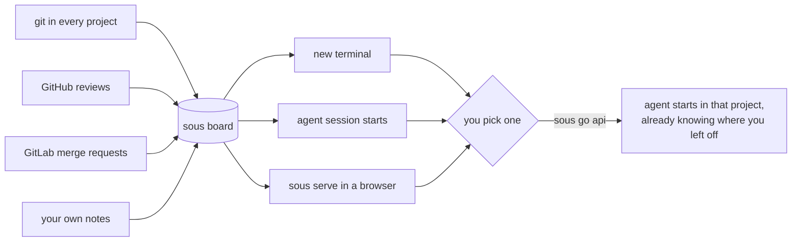

# sous

<picture>
  <source media="(prefers-color-scheme: dark)" srcset="brand/svg/horizontal-on-dark.svg">
  
</picture>

[](https://github.com/bilal-/sous/actions/workflows/ci.yml)
[](https://github.com/bilal-/sous/releases/latest)
[](LICENSE)
[](go.mod)
[](https://axi.md)

One memory across all your projects, for you and your agents.

**[getsous.dev](https://getsous.dev)**

Each agent's memory stays inside the repo it worked in, and so does yours.
Step away from a project for a week and you lose track of what you were doing
and what comes next. sous brings it into one place: what's waiting, where you
left off, and what was decided, across every project.

It keeps track on its own. Every time you look, it reads each project's git
state, your reviews, and the follow-ups and next step the project keeps in
`FOLLOWUPS.md` and `STATUS.md`. It records how each agent session ended, and
agents save the decisions and lessons worth keeping, each with its source.

When you open a terminal you see what's waiting across every project. When an
agent session starts (Claude Code, Codex, Antigravity or opencode), the agent
is told where you left off in that project and what was decided there. It
still works on the days you forget sous exists.

```
sous · ~/.local/bin/sous · one memory across all your projects
sous · 2 on you · 1 on others · 2 unfinished

  on you
  1               billing                   send the pricing copy to Sam                                  6d
  s:0b4ac59dfd33  app-next                  review requested · PR #14 json api                            2d

  on others
  2               mobile-app                waiting on app store review                                   4d

  unfinished
  s:4515743b9362  audio-app                 11 files uncommitted · feat/history                           3mo
  s:fe9c4922caf6  chime                     6 commits unpushed · main                                     6d

  26 checked · 0 unavailable · as of 09:02 · sous snooze <id> to hide a row
```

**On you** is what needs you: reviews people asked you for, and notes you
marked as yours. **On others** is what you're waiting for. **Unfinished** is
work you left behind in git: uncommitted files, unpushed commits, stashes,
oldest first. Every row says how long it has been waiting. When you hand
tasks to agents, they get their own groups at the top: **needs you**, **in
progress** and **ready to review**.

## Why it helps

GitHub, GitLab, issue trackers, a notes app and your own memory each know a
slice of your work, and each has to be opened to be useful. What slips is
what nobody reminds you about: the review someone asked for on Tuesday, the
branch you never pushed, the "I'll fix that later" in a project you haven't
opened in two weeks.

sous pulls those slices into one list and puts it where you already look:
your terminal, your agent, a menu bar, or a page in your browser.



It's for you if you work across many projects, often with AI agents, start
your agents from a terminal, and want a nudge rather than another tool to
manage. It's probably not for you if you mostly work in one project, or your
team already runs everything through one tracker you check every day.

## What sous is, and isn't

sous is an index, not a tracker. Your work stays where it lives: in git, on
GitHub or GitLab, or in a project's own `FOLLOWUPS.md`. sous keeps pointers,
your private notes, sourced memory and links between efforts, and works out
the live state again each time you look.

It has no priorities, due dates, assignees or sprints. The board groups rows
by whose move it is, oldest first. It needs no API key and runs no
background service. It can hand a task to an agent in the background and
follow it, but the agent (through a runner) does the work, not sous. The
full design is in [docs/design.md](docs/design.md).

## Install

    curl -fsSL https://raw.githubusercontent.com/bilal-/sous/main/install.sh | sh

Or `brew install bilal-/tap/sous && sous setup`. Installing finds your
projects, adds the agent hooks and the shell line, and tells you what it
did. Open a new terminal and the board is there. You need `git`; `gh` and
`glab` are optional and sous uses the logins they already have.

[Installing and setting up sous](docs/setup.md) covers building from source,
updating, what setup changes, configuration, what works today, and how to
uninstall.

## A quick tour

    sous                                    the board, fresh
    sous go api                             start your agent in a project, with where you left off
    sous here                               where you left off in this project
    sous note -p billing -k me "send the pricing copy to Sam"
    sous snooze 3 2                         hide note 3 for two days
    sous done 3                             close it
    sous serve --open                       the board in your browser, live
    sous go billing --run "fix the flaky test"   hand a task to an agent in the background

Or just ask your agent: "what's waiting on me?", "note for billing that I
owe Sam the numbers", "have an agent fix the flaky test". It asks before
anything reaches a shared tracker.

[Using sous day to day](docs/guide.md) walks through each of these, sharing
notes with your team, memory across projects, and handing work to agents.
[Using sous with your agent](docs/agents.md) covers each agent's setup.

## How sous stays honest

* **Missing data never looks like zero.** If GitHub can't be reached or a
  folder is missing, the headline says `? on you (github failed)` instead of
  a calm zero, and what sous knew before is kept and marked `(stale)`.
* **Every row has a source.** Notes keep when you wrote them. Signals keep
  the earliest time their source gave, or when sous first saw them. Cached
  and session views say when remote data was last checked.
* **The tracker wins.** If an item you filed is closed where it lives, your
  note closes too, marked as closed upstream. If sous can't check, the row
  says so.
* **Starting a session is always fast.** `sous here`, the session hooks and
  `sous go` never wait on the network.

## All commands

Every option is in [the command guide](docs/commands.md), and each command
explains itself with `--help`. Board views, project lists, notes, reports
and diagnostics take `--json`.

| Command | What it does |
|---|---|
| `sous` | the board for all your projects |
| `sous <folder>` | the board for just the projects in that folder |
| `sous <project>` | where you left off in that project |
| `sous here` | where you left off in this project |
| `sous note [-p project] [-k me\|them\|idea] [--file \| --ref ticket] [--after n] "text"` | write a note |
| `sous edit <n> "text"` | change a note |
| `sous kind <n> me\|them\|idea` | change whose move it is |
| `sous link <n> [--ref ticket] [--after n]` | link a ticket that already exists, or a note this one waits on |
| `sous unlink <n> [--ref] [--after n]` | forget a linked ticket or wait |
| `sous snooze <n\|s:id> [days]` | hide a row for a while |
| `sous show <n>` | one note in full; for a run, how it's going |
| `sous done <n> [--close] [--clean]` | close a note; `--close` closes its tracker item too, `--clean` removes a run's worktree |
| `sous file <n> [--force]` | send a note to the project's tracker |
| `sous review [-p project] [--keep n]` | check follow-ups; keep open ones on the board another week |
| `sous report [--week] [--open]` | what changed lately |
| `sous remember "text"` | keep a sourced handoff, decision, constraint, lesson or question |
| `sous recall [query]` | find project memory, or look at its history |
| `sous memory <action> <m:id>` | verify, forget, share or unshare a memory |
| `sous effort [name]` | link work and blockers across projects |
| `sous projects [name]` | every project sous can see |
| `sous go <project> [-a agent]` | start your agent in a project |
| `sous go <project> --run <brief>` | hand a task to an agent in the background |
| `sous reply <n> "answer"` | answer a run that needs you |
| `sous approve <n>` | publish a run's result: push its branch and open a draft PR |
| `sous discard <n>` | turn a run's result down |
| `sous serve` | the board as a web page on this computer |
| `sous integration [<call>]` | for apps that show sous: discovery, snapshots, changes and actions |
| `sous setup [folder...]` | set everything up; folders say where your projects are |
| `sous config [key value...]` | see or change settings |
| `sous doctor` | check the setup, and how to fix what isn't right |
| `sous update [--check]` | install the latest stable release, or only check |

To write a note that starts with a dash, put `--` before it:
`sous note -- "-2 tests failing"`. Exit codes are in
[the command guide](docs/commands.md#exit-codes).

## Apps and plugins

Apps can show sous in their own interface. The
[herdr plugin](integrations/herdr/README.md) in this repo adds a Tasks pane,
sidebar counts and task actions to herdr. [The integration guide](docs/integrations.md) describes the
contract for any host.

sous grows through small plugins, in any language: **signals** find what's
waiting on you, **backends** are where filed notes go, **launchers** start
an agent or editor, and **runners** do a task in the background. The
built in GitHub, GitLab and git support use the same contract. Start with
[the example plugin](examples/sous-signal-todo), a small shell script, and
[the plugin guide](docs/plugins.md). Connectors we'd especially like to see:
Jira, Linear, Gitea, Bitbucket, Azure DevOps, Sentry and CI status.

## Contributing

sous is a solo hobby project, built in spare time. Bug reports, ideas and
pull requests are welcome and gladly read. I can't promise to get to every
one, or quickly, but I will when time allows. Start with
[CONTRIBUTING.md](CONTRIBUTING.md); [AGENTS.md](AGENTS.md) is the guide for
people and agents working on the code.

    make build          # build bin/sous
    make test           # offline experiment tests, go vet, then Go race tests
    make ci             # formatting, module tidiness and make test; staticcheck if installed

The checks need Python 3.9 or newer for the offline memory experiment tests.
Building and running sous don't.

## Status

sous is before 1.0. Commands and flags may change between minor versions,
and every change is in [CHANGELOG.md](CHANGELOG.md). Your data files always
carry forward: a new version upgrades them, and an older version refuses a
newer file rather than damaging it. The plugin contract only grows until
1.0, which freezes it.

## License

sous is released under the [MIT License](LICENSE). Copyright 2026 Bilal. The
name and logo have a separate [trademark notice](TRADEMARK.md).
