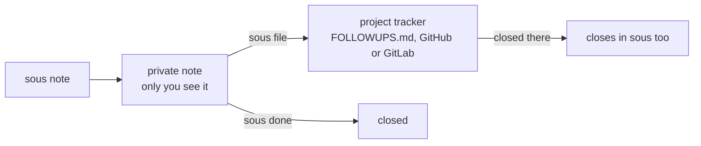

# Using sous day to day

## A few days with sous

**Monday morning.** You open a terminal and the board is already there: two
reviews waiting on you, a note you left on Friday, and a branch in a project
you forgot about with six unpushed commits. You pick the review, type
`sous go app-next`, and your agent starts in that project with a summary of
where things stand.

**In the middle of something else.** You're deep in the API and remember the
billing page needs new copy. Instead of switching, you type
`sous note -p billing -k me "update the pricing copy"` and keep going. It'll
be on the board tomorrow.

**Waiting on someone.** You sent a design to Sam for sign off. You note it
with `-k them`. It sits under "on others" with a growing age, so you notice
when a week has gone by and it's time to nudge.

**Coming back after two weeks.** You open a project you haven't touched in a
while and run `sous here`: the branch, the last commit, how your last agent
session ended, and the ideas you left for later. Five seconds instead of
twenty minutes of digging.

**Your agent keeps notes for you.** In Claude Code you say "remind me to
write the migration test for billing". The agent runs `sous note` for you.
It never files anything where others can see without asking first.

**Friday.** `sous report --week --open` shows what you closed, which projects
had recent commits or recorded session endings, and what is still waiting.

## Start your day

Open a terminal. The board prints from a cache, so it appears at once, and
refreshes in the background when it gets old. Run `sous` to see it fresh.

Pick something and go there:

    sous go api

This starts your agent in the project, with a short summary of where you
left off already in its context. In zsh, with the shell snippet installed,
your terminal is in the project too when the agent exits. Use `-a codex` to
pick a different agent.

## Pick up where you left off

    sous here

In any project, this shows the branch, the last commit, how your last agent
session ended, open notes and ideas for this project, and anything waiting
on you. Agent sessions get the same summary when they start, without you
asking.

## The board in a browser

    sous serve --open

This opens the board as a web page on this computer. It updates live and
works with a mouse or by touch, on any screen size. Items read in plain
words: a git finding says what it means and how to deal with it, and a long
note shows its first sentence as a title. From an item you can close or
snooze it, answer a run, review a result's changes, approve or discard it,
or hand it to an agent. Press and hold an item (or press `x`) to select
several. [The command guide](commands.md#sous-serve) has the details and
keys.

## Keep the handoff and follow-ups current

`sous here` points to the project's own documents: `STATUS.md` for the
current state, checks, blockers and next step; `FOLLOWUPS.md` for unfinished
actions; and `AGENTS.md` or `CLAUDE.md` for working instructions. Agents
follow the project's conventions and keep the handoff current as they work.
Creating shared documents and filing private notes still need you to ask.

The board reminds you when notes need checking. Run `sous review`, look at
what actually happened, then close finished work with `sous done <n>`, or
keep an open note with `sous review --keep <n>`. Keeping it resets the
reminder for a week while the task stays on the board. Tracker items closed
elsewhere close here on their own, and notes you close leave the cached shell
and menu bar views at once.

## Catch a thought before it slips away

You're deep in one project and remember something about another. Write it
down without leaving:

    sous note -p billing -k me "send the pricing copy to Sam"

`-p` finds the project by a rough name. If the name matches more than one
project, sous lists them and asks you to be specific. It never guesses.

`-k` says whose move it is: `me` for your job, `them` when you're waiting on
someone. Leave it out for an idea, which stays off the main board and shows
up when you next open that project.

You can also just ask your agent: "sous, note for billing that I owe Sam the
numbers." The skill points it at sous, and sous shows it how.

## Share a note with the team

Notes are private until you choose otherwise. When a note should live in the
project's tracker, file it:

    sous file 3

sous puts it where the project already keeps work: `FOLLOWUPS.md` if the
project has one, then GitHub issues, then GitLab issues. From then on, sous
checks that item each time it builds the board. Close it there, by ticking
the box or closing the issue, and it closes in sous too.



To close both at once from your side:

    sous done 3 --close

Plain `sous done 3` only closes your note. Nothing reaches a shared tracker
unless you ask.

## Quiet the noise

For a row you know about but can't act on yet:

    sous snooze 3 2              hide note 3 for two days
    sous snooze s:fe9c4922caf6   hide a git or GitHub row until it changes

## Look back on your week

    sous report --week --open

This opens a simple page in your browser: what's new on you, what got
closed, which projects you worked in, and what needs a look. Plain
`sous report` shows what changed since your last report, in the terminal.

## Keep context across projects

Keep decisions, constraints, lessons and handoffs with their sources. When
you come back to a project, its brief brings that context up; the full
history stays on your computer.

```sh
sous remember -k decision --source docs/design.md "Use cursors for pagination"
sous recall pagination
sous recall --show m:1
sous memory verify m:1 --source docs/design.md
sous effort add "Account launch"
sous effort link "Account launch" --project acme/api --project acme/site
sous effort "Account launch"
```

An effort ties projects and existing notes to one outcome. Link notes with
`--note`, then describe what blocks what with `depend --note 8 --after 7`.
Counts follow current commitments; an effort never changes a task's status.

Memory stays with its project and workspace unless you share it. A project
you name keeps its named scope; an absolute path picks that exact checkout.
If the current folder could belong to more than one scope, or sous can't
tell, briefings still show project facts and notes, say what's wrong, and
leave private context out. Use `--supersedes` when a decision changes, and
`sous memory forget` to remove what was stored.
[The command guide](commands.md#memory-and-efforts) covers scope,
verification, sharing, history and retries.

## Hand work to an agent

Tell your agent what you want done, and let it hand the task off:

> "Have an agent fix the flaky test in billing. It fails about one run in
> five since the fixtures changed."

Your agent runs `sous go billing --run -` with a full brief. Another agent
starts on it in the background, in its own git worktree, so its edits stay
apart from your checkout. The board shows it at the top, under in progress:

    sous · ~/.local/bin/sous · what is waiting on you across every project
    sous · 1 running

      in progress
      7               billing                   fix the flaky test · running                                  4m

      26 checked · 0 unavailable · as of 09:02 · sous snooze <id> to hide a row

If the agent has a question, the task moves to needs you. When you open a
new session, your agent hears about it first:

    [sous] Runs waiting on the user:
      7 billing: run needs you · fix the flaky test · "which fixture should win?" · sous reply 7 "<answer>"

You answer in plain words, your agent runs `sous reply 7 "…"`, and the run
carries on. When it's done, the task moves to ready to review, with how
many files changed and whether its checks passed. `sous show 7` gives the
branch to look at, or says the changes are waiting, not yet committed, in
its worktree. Built in runners tell the agent not to push and block ordinary
git pushes; the agent's own permissions still apply (see
[SECURITY.md](../SECURITY.md)). When you're finished with it, run
`sous done 7 --clean`.
